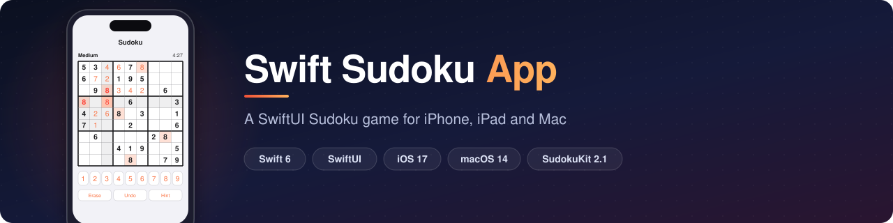

<p align="center">
  
</p>

# Swift Sudoku App

A SwiftUI Sudoku game for iPhone, iPad and Mac, built on
[SudokuKit](https://github.com/tkausch/swift-sudoku-solver) 2.1.

## Features

- New puzzles in three difficulties (easy, medium, hard), each with exactly one solution
- Eight well-known puzzles, from the Wikipedia example to AI Escargot
- Conflicting digits in red; the selected cell's row, column, box and matching digits highlighted
- Hint, erase and undo on the number pad
- Restart, show the solution, and a timer that pauses in the background

## Requirements

iOS 17 or macOS 14, Xcode with Swift 6.

## Run

**iPhone and iPad:** open `iOS/Sudoku.xcodeproj`, choose the **Sudoku** scheme and a
device or simulator, and run. To run on a device, pick your team under Signing &
Capabilities and change the bundle ID prefix in `iOS/project.yml` (see below).

**Mac:**

```sh
swift run SudokuApp
```

**Tests:**

```sh
swift test
```

## Structure

```
Package.swift            SudokuAppUI library and the macOS app
Sources/SudokuAppUI      SudokuSession, SudokuRootView, SudokuSessionView
Sources/SudokuApp        macOS app
Tests/SudokuAppUITests   tests for SudokuSession
iOS/project.yml          XcodeGen spec for the iOS app
iOS/Sudoku.xcodeproj     generated iOS project
iOS/Sudoku               iOS app
```

Almost everything comes from SudokuKit: puzzles, generating, solving, undo, hints, and the
`SudokuBoardView` and `SudokuNumberPad` views. The app adds:

- `SudokuSession`: wraps SudokuKit's `SudokuGame` and adds the game's status (playing,
  won, revealed) and a timer. The number pad edits a `SudokuGame` directly, so it is
  bound through `SudokuSession.apply(_:)`, which notices when the puzzle is solved.
- `SudokuRootView`: the New Game menu, Restart and Show Solution.
- `SudokuSessionView`: title, timer, board, number pad and the "Solved!" banner.

## The iOS project

SwiftPM can't build an iOS app bundle, so the iOS app is a small Xcode project that links
the `SudokuAppUI` library. Don't run the package's `SudokuApp` scheme on an iPhone: it is
built as a bare executable, and UIKit stops it at launch ("missing bundleID for main bundle").

The project is generated with [XcodeGen](https://github.com/yonaskolb/XcodeGen) from
`iOS/project.yml`. It is checked in, so you don't need XcodeGen just to build. After
changing `project.yml`, for example to set your own bundle ID prefix, regenerate it:

```sh
cd iOS && xcodegen
```
