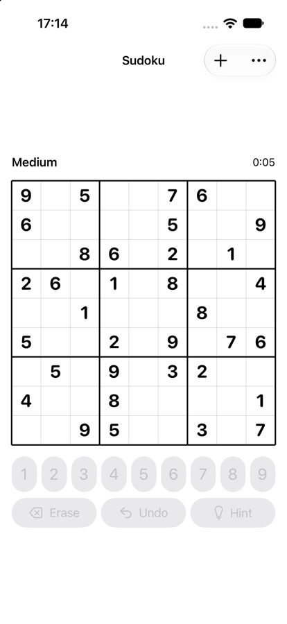

<p align="center">
  
</p>

# Swift Sudoku App

A SwiftUI Sudoku game for iPhone, iPad and Mac, built on
[SudokuKit](https://github.com/tkausch/swift-sudoku-solver) 2.1.

The app is deliberately small, under 300 lines of Swift. SudokuKit does the real work:
generating, solving, undo, hints, and the board and number pad views. The app adds a
menu, a timer, and the logic that notices when a game is won. That makes it a compact
example of how to build a complete SwiftUI app on top of a Swift package.

<p align="center">
  
</p>

## Features

- New puzzles in three difficulties, each with exactly one solution
- Eight famous puzzles, from the Wikipedia example to AI Escargot
- Conflicting digits in red; the selected cell's row, column, box and matching digits highlighted
- Hint, erase and undo on the number pad
- Restart, show the solution, and a timer that pauses in the background
- Same code on iPhone, iPad and Mac, in light and dark mode

## How to play

Fill every row, column and 3×3 box with the digits 1 to 9, each exactly once.

| To… | Do this |
|---|---|
| Enter a digit | Tap a cell, then a digit on the number pad |
| Clear a cell | Select it and tap **Erase** |
| Take back a move | Tap **Undo**, as often as you like |
| Get help | Select a cell and tap **Hint** to fill in its correct digit |
| Start over | **Restart** in the toolbar (under **⋯** on iPhone) |
| Give up | **Show Solution** in the toolbar; this ends the game |
| Play something else | **+** in the toolbar |

Digits that clash with another digit in their row, column or box turn red. A digit that
is wrong but doesn't clash yet isn't marked, so a hint is the way to check a cell. When
every cell is right, the game shows **Solved!** with your time.

## Puzzles

**New Puzzle** generates a fresh grid with SudokuKit's `SudokuGenerator`. Every generated
puzzle can be solved by logic alone, without guessing; the difficulty sets how many clues
it keeps:

| Difficulty | Clues |
|---|---|
| Easy | at least 42 |
| Medium | at least 34 (the app starts with one) |
| Hard | as few as possible, typically 27–32 |

**Classic Puzzles** are eight well-known grids from SudokuKit's `SudokuPuzzle.all`, from
easy to some of the hardest ever published:

- Wikipedia example
- Project Euler #96, grids 01 and 02
- Peter Norvig, grid 2
- Arto Inkala, "world's hardest"
- Easter Monster
- Golden Nugget
- AI Escargot

## Requirements

- iOS 17 or macOS 14
- Xcode with Swift 6
- [XcodeGen](https://github.com/yonaskolb/XcodeGen), only to change the iOS project

## Getting started

```sh
git clone git@github.com:tkausch/swift-sudoku-app.git
cd swift-sudoku-app
```

**iPhone and iPad:** open `iOS/Sudoku.xcodeproj`, choose the **Sudoku** scheme and a
simulator or device, and run. To run on your own device, pick your team under
**Signing & Capabilities** and set your own bundle ID prefix (see [The iOS project](#the-ios-project)).

**Mac:**

```sh
swift run SudokuApp
```

You can also open `Package.swift` in Xcode and run the `SudokuApp` scheme on **My Mac**.

## Project structure

```
Package.swift                SudokuAppUI library and the macOS app
Sources/SudokuAppUI/
  SudokuSession.swift        game state: SudokuKit's SudokuGame plus status and timer
  SudokuRootView.swift       navigation, New Game menu, Restart, Show Solution
  SudokuSessionView.swift    title, timer, board, number pad and the Solved! banner
Sources/SudokuApp/App.swift  macOS app
Tests/SudokuAppUITests/      tests for SudokuSession
iOS/project.yml              XcodeGen spec for the iOS app
iOS/Sudoku.xcodeproj         generated iOS project (checked in)
iOS/Sudoku/Sudoku.swift      iOS app
assets/                      banner and screenshot for this README
```

## How it works

### What comes from SudokuKit

| SudokuKit | Used for |
|---|---|
| `SudokuGenerator`, `SudokuDifficulty` | New puzzles |
| `SudokuPuzzle.all`, `SudokuParser` | Classic puzzles |
| `SudokuGame` | Givens, entries, undo history, `isSolved`, and the solution (computed once and stored) |
| `SudokuBoardView` (SudokuUI) | The board, selection highlighting and conflict colouring |
| `SudokuNumberPad` (SudokuUI) | Digits, Erase, Undo and Hint |

### SudokuSession

`SudokuSession` is an `@Observable` class that holds one `SudokuGame` and adds only what
SudokuKit doesn't have:

- `status`: `.playing`, `.won` or `.revealed`
- a timer: `elapsed(at:)`, `pause()` and `resume()`
- `restart()` and `revealSolution()`

`SudokuNumberPad` edits a `SudokuGame` through a binding. The view binds it through the
session, so every change passes through `apply(_:)`, which marks the game as won once
the board is solved:

```swift
SudokuBoardView(game: session.game, selection: $selection)
SudokuNumberPad(game: Binding(get: { session.game }, set: { session.apply($0) }),
                selection: selection)
```

New games are generated and solved off the main thread
(`SudokuSession.generate(_:)` and `load(_:)`), so the UI never waits for the solver. The
solution is computed then because `SudokuGame.solution` stores its result the first
time it's read. Reading it later, while a view draws, would change the observed game.

## Testing

```sh
swift test
```

The tests use Swift Testing and cover `SudokuSession`: applying changes, ignoring moves
after the game ends, winning, restarting, the paused clock, generating every difficulty,
and loading every classic puzzle.

## The iOS project

SwiftPM can't build an iOS app bundle, so the iOS app is a small Xcode project that links
the `SudokuAppUI` library. Don't run the package's `SudokuApp` scheme on an iPhone: it is
built as a bare executable, and UIKit stops it at launch ("missing bundleID for main bundle").

The project is generated with XcodeGen from `iOS/project.yml` and checked in, so you
don't need XcodeGen just to build. After changing `project.yml`, for example to replace
the placeholder bundle ID prefix `com.example`, regenerate it:

```sh
cd iOS && xcodegen
```

## Related

- [swift-sudoku-solver](https://github.com/tkausch/swift-sudoku-solver): SudokuKit, the
  solver, generator and SwiftUI views this app is built on, plus a command-line solver
